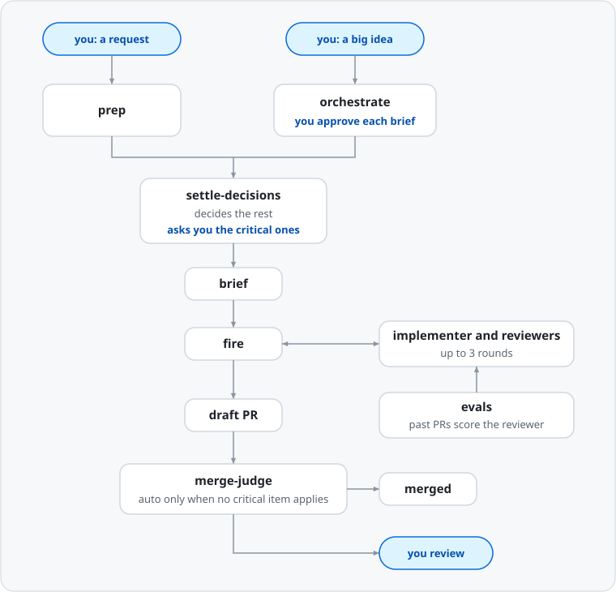

# Skills



## Installation

1. Run `claude` in any repo.
2. Run `/plugin marketplace add mithredate/skills`.
3. Run `/plugin` with no name. It opens the Discover tab, which lists the plugins of the marketplaces that you added.
4. Run `/plugin install <plugin-name>@skills` for each plugin that you want.

The official guide is [Install and manage plugins](https://code.claude.com/docs/en/discover-plugins).

`managed-settings.json` at the repo root holds every machine-wide Claude Code setting, not only the sandbox. It turns on the Claude Code sandbox, sets the package cooldowns, and sets the default subagent model and permission mode. A plugin cannot turn on the sandbox. Run these commands to link the installed copy as the managed settings file, so that every session loads it. `ln -sfn` also replaces an existing link.

```bash
sudo mkdir -p "/Library/Application Support/ClaudeCode"
sudo ln -sfn ~/.claude/plugins/marketplaces/skills/managed-settings.json "/Library/Application Support/ClaudeCode/managed-settings.json"
```

To run sessions without the sandbox, delete the link.

```bash
sudo rm "/Library/Application Support/ClaudeCode/managed-settings.json"
```

Start a new session after you add or delete the link. `/status` warns that the link leads outside the system folder. This warning is expected.

## Machine setup

In 2026, attackers used hijacked maintainer accounts to publish malicious new versions on npm and PyPI. With these settings, npm, pnpm, and uv refuse a version that is younger than 7 days.

The managed settings link of `managed-settings.json` sets the cooldown for every Claude Code session. Its `env` block sets `npm_config_min_release_age`, `pnpm_config_minimum_release_age`, and `UV_EXCLUDE_NEWER`. These variables override the value in a project's `.npmrc` or `pnpm-workspace.yaml`. uv needs 0.9.17 or later to read the duration in `UV_EXCLUDE_NEWER`. A plugin cannot set package-manager config. For your own terminal, apply the settings below once on each machine.

| Tool | Setting | 7-day value | Minimum version | Command or config file |
|---|---|---|---|---|
| npm | `min-release-age` | `7` (days) | 11.10.0 | `npm config set min-release-age 7` |
| pnpm | `minimumReleaseAge` | `10080` (minutes) | 10.16.0 | `pnpm config set --global minimum-release-age 10080` |
| uv | `exclude-newer` | `"7 days"` | 0.9.17 | Add `exclude-newer = "7 days"` to `~/.config/uv/uv.toml` |

`min-release-age` needs npm 11.10.0 or later. Node 22 ships npm 10, which does not have the setting. Run `npm --version` before you set it.

For an urgent fix that is younger than 7 days, exclude only that package:

| Tool | Exclude setting | Minimum version | Example |
|---|---|---|---|
| npm | `min-release-age-exclude` | 11.17.0 | `npm install <pkg>@<version> --min-release-age-exclude=<pkg>` |
| pnpm | `minimumReleaseAgeExclude` | 10.19.0 | Add `<pkg>@<version>` to `minimumReleaseAgeExclude` in the project's `pnpm-workspace.yaml` |
| uv | `exclude-newer-package` | 0.9.25 | `uv add <pkg>==<version> --exclude-newer-package <pkg>=false` |

## Attribution

[`NOTICES.md`](NOTICES.md) lists the upstream source and the license of each vendored skill.
